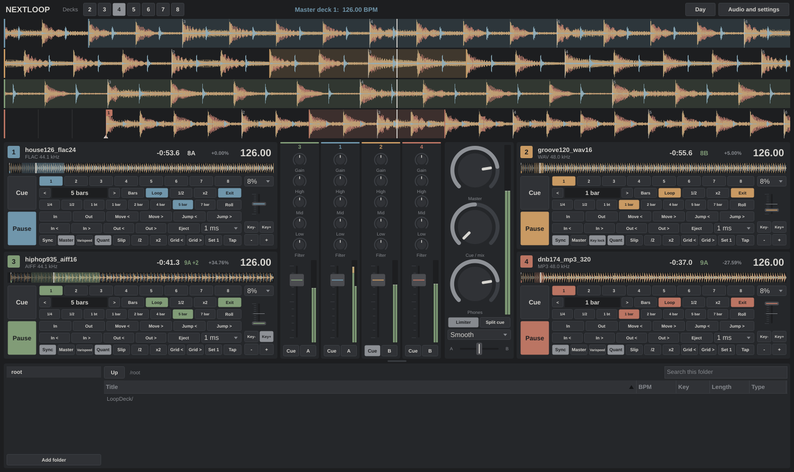

# NEXTLOOP

A DJ and loop-production app for Windows and macOS. Two to eight decks, beat sync, key lock, any-length loops (5, 7, 12, 13 bars…), and a mixer with isolator EQs and one-knob filters.



This is **phase 1** of the build: the audio engine, decks, loops, sync, mixer and a folder browser. FX, granular, the full library, MIDI mapping and the loop-production tools come in the next phases (see the roadmap below).

## Getting the app

Every push to `main` builds the apps on GitHub:

1. Open the repository's **Actions** tab and pick the latest green run.
2. Download the version for your computer from the Artifacts section:

| Download | Runs on |
|---|---|
| NEXTLOOP-Windows10-11-x64 | Windows 10 (version 1607 or later) and 11, 64-bit. Draws with the graphics card, so it's the lightest on CPU. |
| NEXTLOOP-Windows7-x64 | Windows 7 SP1, 8, 8.1, 10 and 11, 64-bit |
| NEXTLOOP-Windows7-x86 | The same, for 32-bit Windows. A 32-bit app can only address about 2 GB, so very long files on many decks at once may not load. |
| NEXTLOOP-macOS-universal | macOS 10.13 High Sierra or later, Apple Silicon and Intel |

3. Unzip.
   - **Windows:** run `NEXTLOOP.exe`. SmartScreen may warn about an unrecognised app; choose *More info → Run anyway*.
   - **macOS:** move `NEXTLOOP.app` to Applications. The first time, right-click it and choose *Open* (the app isn't notarised with a paid Apple Developer account).

Pushing a tag such as `v0.1.0` also publishes all four zips as a GitHub Release.

## Using it

**Audio setup.** Click *Audio and settings*. Pick your interface (ASIO or WASAPI on Windows, CoreAudio on Mac), sample rate and buffer size. Choose which output pair is the master and which goes to your headphones. With a single stereo output, turn on *Split cue* in the mixer: cue plays in the left ear and master in the right.

**Loading tracks.** You can load in any of these ways:
- Double-click a track in the browser to load it to the next free deck.
- Drag it onto any deck or waveform.
- Right-click it and choose a deck.
- Drag files straight from Finder or Explorer.

The first load decodes and analyses the file; after that it loads instantly from the cache.

**Formats.** NEXTLOOP reads:
- WAV (16/24/32-bit integer and 32-bit float, any sample rate, including RF64 for files over 4 GB)
- AIFF and AIFF-C (including `sowt` little-endian and 32-bit float)
- FLAC (16/24-bit)
- MP3 (every bitrate, CBR and VBR, mono or stereo)
- Ogg Vorbis
- On macOS, also M4A/AAC and ALAC.

**Large files.** Decoded audio lives in a memory-mapped cache on disk, not in RAM, so hour-long mixes and 192 kHz files are fine. A track is playable as soon as its first seconds are decoded. Cache size is set in settings (20 GB by default). Beat grids and cue points are kept even when old audio is cleared from the cache.

**Decks.** The buttons at the top switch between 2 and 8 decks. Up to 4 decks use stacked horizontal waveforms with a central mixer. At 5 to 8, each deck becomes a short vertical strip with its own vertical waveform and channel controls.

**Loops.**
- **Lengths:** *Bars* / *Beats* switches the unit. `<` and `>` step through 1/32 beat up to 16 beats, or 1 to 32 bars plus 48 and 64. Every whole bar count is included: 5, 7, 12, 13 and so on.
- **Typed lengths:** click the length display to type any length, such as `13 bars`, `7`, `3 beats` or `1/4`.
- **Quick buttons:** the eight quick-loop buttons are yours to set. Right-click one to change it.
- **Roll:** with *Roll* on, the quick buttons become momentary loop rolls. The track keeps moving underneath and resumes where it would have been when you let go.
- **In / Out:** set a manual loop. *Exit* / *Reloop* leaves the loop or re-enters the last one. *1/2* and *x2* halve and double the loop. *Move* shifts it by its own length; hold shift to shift by one beat.
- **Fine adjust:** *In < >* and *Out < >* nudge the loop points by the chosen step (1 sample, 1 ms, 10 ms, 1/64 or 1/16 beat). Nudges of 1 ms and larger snap to the nearest zero crossing so loops don't click.

**Varispeed and key lock.** Each deck's key lock button switches between two ways of changing tempo:
- **Varispeed:** pitch moves with the tempo, like speeding up a record.
- **Key lock:** time-stretching keeps the key.

*Key-* and *Key+* transpose by semitones in either mode. The key display follows the shift round the Camelot wheel, so 8A +1 shows as 3A. Right-click a key button to reset it.

**Stretch sounds.** Pick the default in settings, or right-click a deck's key lock button to choose per deck:

| Sound | Character | CPU per deck |
|---|---|---|
| Light (default) | Splices the audio at matching points, like classic DJ key lock. Clean for normal tempo changes; can flam a little on big ones | 0.8 % |
| Studio | Signalsmith Stretch, spectral. Smoother on big changes and sustained sounds | 1.9 % |
| Vintage sampler | Overlapping grains, 90s hardware sampler warble | 0.3 % |
| Vintage phase vocoder | Textbook vocoder: smeared, phasey, underwater | 3.0 % |
| Vintage cyclic | Hard-spliced cycles: stuttery and glitchy | 0.3 % |

CPU figures are a share of one core on the test machine, with key lock on.

**Tempo range.** The range menu next to each tempo fader offers ±4 %, ±8 %, ±16 %, ±50 % and 0–200 %. At 0–200 % the fader runs from a full stop to double speed, in varispeed or key lock. At 0 % the deck is silent, like a stopped record.

**Light on CPU.** Eight decks in varispeed, mixer included, use about 2 % of one core; with Light key lock on all eight, about 6.5 %. A few things keep it that way:
- **Waveforms:** each is drawn once into an off-screen strip and slid into place as the track plays. Decks that aren't moving don't redraw at all.
- **Screen refresh:** set it to 30 frames per second in settings to halve the drawing cost.
- **Idle decks:** silent channels can't trigger the slow "denormal" maths that makes some audio apps spike when a track ends.

**Looks.** Two switches at the top give four looks. *Day* / *Night* picks a white or dark interface. *Mono* / *Colour* switches between a clinical greys-only look (decks told apart by number) and muted nature colours that mark each deck and its state. Both use greys for the interface itself.

**Sync.**
- **Sync** locks tempo and beat phase to the master deck.
- **Master** pins a deck as the master. Otherwise the deck that has been playing longest leads, and the clock carries on at the same tempo and phase when every deck stops.
- **Octave matching:** tracks are matched at the nearest octave, so a 174 BPM track syncs to 126 as 126, not 252.
- **Key lock** keeps pitch steady while the tempo changes.

**Cues.**
- **Cue:** CDJ-style. While playing, it returns to the cue point and stops. While stopped, it sets a new cue point, or previews from the cue point while held.
- **Hot cues:** click an empty pad to set one, click a set pad to jump to it. Right-click or shift-click to delete.
- **Quantize:** cues, loops and jumps snap to the grid and keep the beat phase.

**Beat grid.**
- **Fixing the tempo:** double-click the BPM to type a value, use */2* and *x2* for half or double, or tap along with *Tap*.
- **Fixing the downbeat:** *Grid < >* shifts the grid by 5 ms (1 ms with shift). *Set 1* makes the playhead the first beat of a bar.
- **Saving:** edits are saved with the track.

**Scratch and nudge.** Drag any scrolling waveform to scratch; it also scrubs while stopped. The *-* and *+* buttons bend the tempo while held. Mouse wheel over a waveform zooms.

**Keyboard.** Keys 1–8 play or pause that deck.

## Verified behaviour

`NEXTLOOPTests` checks the engine headlessly; the same test runs on every push. On synthetic tracks with known tempo, beat positions and key:

- **BPM:** exact (0.000 error) for 93.5, 120, 126 and 174 BPM, across WAV, AIFF, AIFF-C, FLAC and MP3 at 44.1, 48 and 96 kHz.
- **Beat grid:** placed within 0.2 ms on every lossless format. MP3 grids sit about 25 ms later, which is the encoder delay the MP3 decoder plays back. The grid matches what you hear, so it doesn't affect beatmatching in NEXTLOOP.
- **Key:** detected correctly on every test track.
- **Loops:** 5, 7, 12 and 13-bar loops repeat with under half a sample of drift per cycle. 1-sample fine adjustments are exact. Loop rolls return to within 0.01 ms of the slipped position.
- **Sync:** phase error under 0.001 beats, including after the master changes tempo and with key lock on.
- **Key lock:** a 440 Hz tone at +8 % tempo stays at 440 Hz on every stretch sound (435 Hz on the deliberately warbly vintage sampler); with varispeed it rises to 475 Hz. A key shift of -3 semitones lands on 370 Hz.
- **Full tempo range:** at 50 %, 150 % and 200 % the deck plays at exactly that speed, with pitch following in varispeed (220, 660, 880 Hz) and holding at 440 Hz with key lock. At 0 % it is silent.
- **Stretched audio stays on the grid:** on a click track, stretched output lands within 1.7 ms of the beat grid on Light, 0.35 ms on Studio, and within 2 ms on the vintage sounds.
- **Large files:** a 60-minute WAV is playable 11 ms after loading and fully analysed in under 8 seconds.
- **Load:** eight decks playing use about 2 % of one CPU core in varispeed and 6.5 % with Light key lock.
- **Both framework versions:** the tests pass on JUCE 9 (Windows 10/11 and Mac builds) and JUCE 7 (Windows 7 builds).

## Building from source

You need CMake 3.22+ and a C++17 compiler: Visual Studio 2022 on Windows, Xcode on macOS. JUCE is downloaded automatically during configuration.

**Windows 10/11:**

```
cmake -S . -B build -G "Visual Studio 17 2022" -A x64
cmake --build build --config Release --target NEXTLOOP
```

**Windows 7 and later** (uses JUCE 7.0.12; `-A Win32` for 32-bit):

```
cmake -S . -B build7 -G "Visual Studio 17 2022" -A x64 -DLOOPDECK_JUCE_VERSION=7.0.12
cmake --build build7 --config Release --target NEXTLOOP
```

**macOS (universal):**

```
cmake -S . -B build -G Xcode -DCMAKE_OSX_ARCHITECTURES="arm64;x86_64"
cmake --build build --config Release --target NEXTLOOP
```

**Engine tests:** needs Python 3 with numpy, plus ffmpeg, to generate the test audio.

```
cmake -S . -B build-tests -DLOOPDECK_BUILD_APP=OFF
cmake --build build-tests --target NEXTLOOPTests
python3 Tests/make_test_audio.py testaudio
./build-tests/NEXTLOOPTests_artefacts/Release/NEXTLOOPTests testaudio
```

## Roadmap

1. **Core (this build):** engine, 2–8 decks in both layouts, cached decoding of large files, BPM/grid/key analysis, sync, loops with odd lengths and fine adjust, mixer, folder browser.
2. **FX and granular:**
   - Per-deck and master FX chains: brake, backspin, echo out, beat roll, delays, reverbs, filters, flanger, phaser, bitcrusher, gate and the rest of the agreed list.
   - Granular mode on every deck.
3. **Library:** crates and playlists, smart crates, tag reading, batch analysis, search, and import from Rekordbox, Traktor and Serato.
4. **Production and control:**
   - MIDI learn with LED feedback and saved mappings.
   - MIDI clock.
   - Sampler / loop bank.
   - Recording and WAV export.

## Code map

| Path | What it does |
|---|---|
| `Source/engine/Track.*` | Decoded track in a memory-mapped cache; waveform bins, grid and cues |
| `Source/engine/TrackLoader.*` | Decoding, cache management, analysis jobs |
| `Source/engine/Analysis.*` | Tempo, beat grid, key and loudness detection |
| `Source/engine/Deck.*` | Playback, key lock, loops, cues, slip, sync |
| `Source/engine/Mixer.*` | Isolator EQ, filter, faders, crossfader, cue bus, limiter |
| `Source/engine/AudioEngine.*` | Audio device, master clock, command queue, routing |
| `Source/ui/*` | Interface |
| `Tests/` | Headless engine tests and test-audio generator |

Third-party code: [JUCE](https://juce.com) (AGPLv3 / commercial) and [Signalsmith Stretch](https://github.com/Signalsmith-Audio/signalsmith-stretch) (MIT). The Light and vintage stretch sounds are NEXTLOOP's own code. The ASIO SDK headers (bundled with JUCE 9, copied in `ThirdParty/asio` for the JUCE 7 build) are GPLv3. That's all fine for your own use; if you ever sell NEXTLOOP, JUCE needs a commercial licence.
